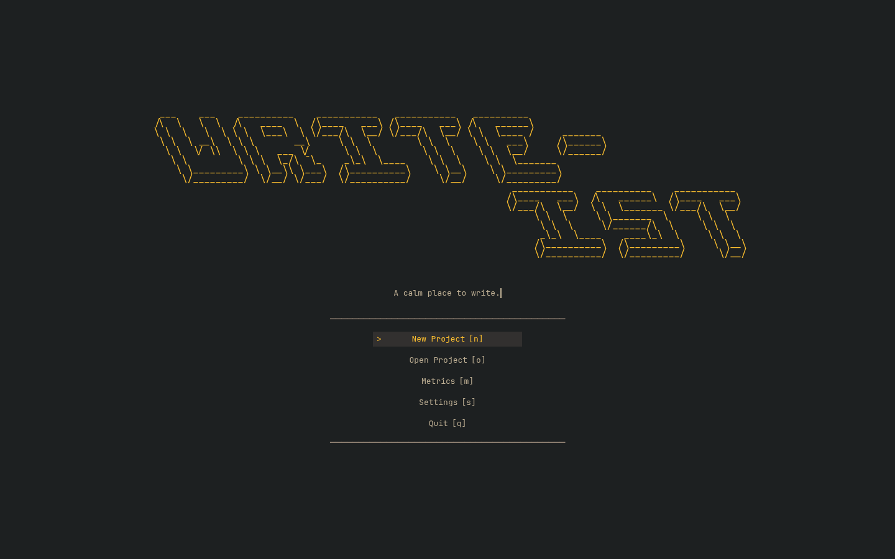
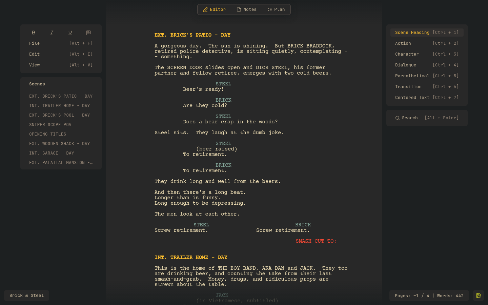

# Write-ist

**A free, lightweight desktop app for writers. It runs on your machine, writes to your files, and reports to no one.**

Write-ist is for writers who want a calm, fast place to write that they actually own. No account,
no subscription, no cloud: none of the usual rentware. Your work is bare text sitting in a folder
on your disk, and it stays readable in any text editor for centuries from now, even if Write-ist disappears tomorrow.

Screenplay is the only format available right now. Other formats are coming. Write-ist is built and
tested on **Linux**. It should also run on Windows and macOS, but nobody has tested those yet,
so expect VERY rough edges.





*The editor, showing the public sample screenplay* Brick & Steel *by Stu Maschwitz.*

## Philosophy

Write-ist is the punk rock middle finger to our current cyberpunk tech overlords, who
use terms like "industry standard" to force us into tools that are out of date, poorly
maintained, slow, buggy, inflexible, grossly overpriced, and designed to squeeze every bit of
ownership away from their users, treating us more like data cattle than customers.

So, in plain terms:

- **It's free.** Not a trial, not freemium. Free.
- **It's open source**, under the MIT license. Read it, fork it, take it apart.
- **Your files are plain files you own.** A project is an ordinary folder, and a screenplay
  inside it is a [Fountain](https://fountain.io) text file. No proprietary format, no lock-in, no standard tax.
- **No account.** Nothing to sign up for, nothing to log in to, no profile kept on you.
- **No cloud.** Nothing you write leaves the machine (unless you want it to, any project folder can be saved in the cloud).
- **It runs gridless:** offline, all of it, all the time.

## Inventory

Everything below is in the app now.

**Writing**

- **A screenplay editor laid out in industry format.** You write directly on the paper: sheets
  set in Courier Prime with standard margins, scene headings, action, character cues, dialogue,
  parentheticals, transitions and dual dialogue all in their proper places. The paper is drawn
  as separate sheets with page numbers, and (MORE) / (CONT'D) where a speech runs onto the next
  page.
- **The keys you expect.** Enter and Tab move between element types, character cues capitalise
  themselves, (CONT'D) is added when a character keeps talking, and bold, italic, underline,
  undo/redo, cut, copy and paste all work.
- **It saves itself.** A couple of seconds after you stop typing, when you switch to another
  app, and when you close the project. If another program changes your script while it's open,
  Write-ist won't write over that change.
- **Autocomplete** for character cues and scene headings, from the names and locations already
  in your script.
- **Character and location lists**, built from your script. Once a name or location has been
  used a few times, autocomplete offers it and spellcheck knows it.
- **Spellcheck, on demand.** Off until you turn it on (View ▸ Spellcheck). Right-click a flagged
  word for suggestions or to add it to your dictionary. Adding a word in a character cue, or in a
  scene heading's location, also adds that name to the project's list. It runs entirely on your computer and phones nothing home.
- **Search** through the script, and jump to any match.
- **Page and word counts** along the bottom of the window, kept up to date as you type.
- **Writing goals.** A daily word goal with a streak, one-off sprints, and a thirty-day chart.

**Title page**

- **Edit Title Page** to fill in the title, credit, author, contact and the rest.
- **View Title Page** to preview it as it will print.

**Getting scripts in and out**

- **Import a Fountain file** to start a project from a script you already have.
- **File ▸ Export As** puts every way out in one dialog:
  - **PDF**, laid out to industry format, with your title page in front. Export all pages or
    a range. A range keeps its printed page numbers, and the title page comes along when the
    range starts at page 1.
  - **Fountain**: a clean copy of the whole script to hand to someone else, with your private
    notes and cut material left out.

**Projects**

- A **Home** screen and an **Open Project** screen listing your projects.
- **Rename** or **delete** a project from its right-click menu. Deleting is recoverable: the
  project is moved to a `Deleted Projects` folder, never erased, and moving it back restores it.

## Use cases

- **Write a screenplay from scratch.** Create a project and start typing.
- **Bring in a script you already have.** Import a Fountain file and keep going.
- **Hand your script to someone else.** Use File ▸ Export As for a PDF of all or some of its
  pages, or a clean Fountain copy.

None of it needs a network.

## Build it yourself

There are **no packaged releases yet**, so for now Write-ist runs from source. At least you
know exactly what you are running.

These steps are for Linux. Windows and macOS are untested.

You need:

- a [Rust toolchain](https://www.rust-lang.org/tools/install)
- WebKitGTK 4.1 (on Debian or Ubuntu, `libwebkit2gtk-4.1-dev` and its companions; the full list
  is in [`.github/workflows/ci.yml`](.github/workflows/ci.yml))
- Node.js and npm

Then, from this folder:

```
npm install
npm run app          # build and launch Write-ist
```

To check your copy:

```
npm test             # the test suite
npm run typecheck    # the TypeScript type check
```

Some tests need a local corpus path (`$WRITE_IST_CORPUS`) and skip when it is absent.

## Early days

Write-ist is unfinished. It is early, it is being worked on, and things may change without notice. If you're
curious how it's going, [`SETUP-CHECKLIST.md`](SETUP-CHECKLIST.md) and the
[GitHub issues](https://github.com/nwilps/write-ist/issues) show where it is. The design
decisions behind the app, each with its reasons, are in [`docs/adr/`](docs/adr/).

## License

[MIT](LICENSE) © Noah Wilps
